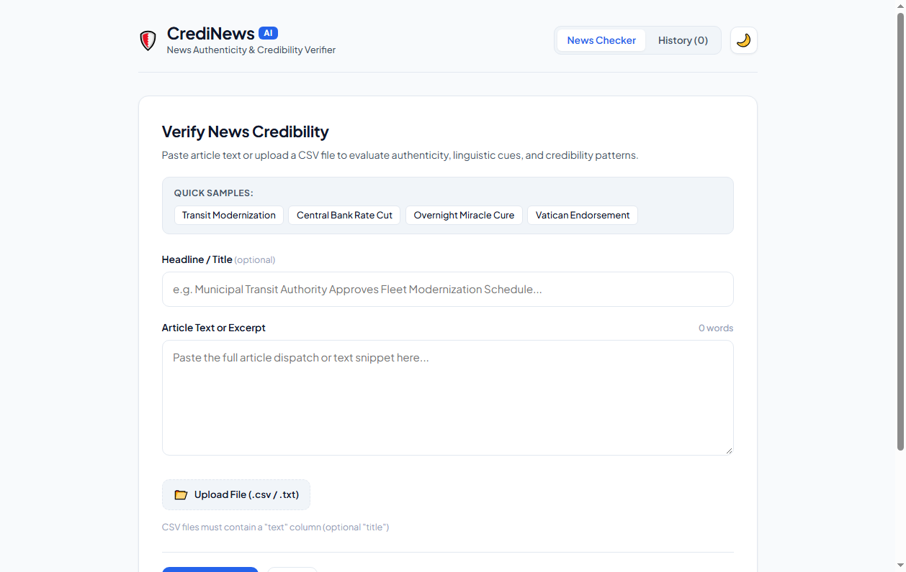
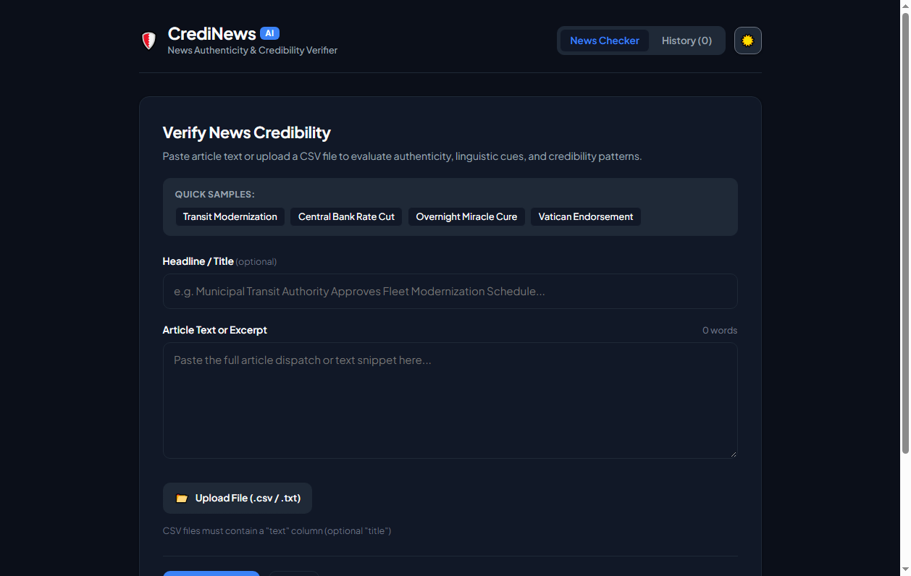
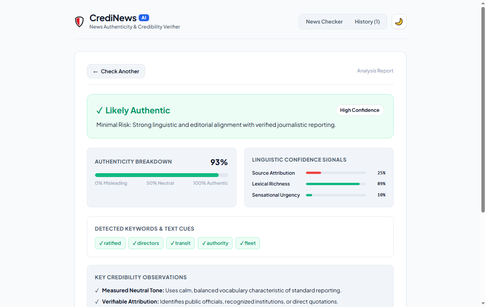
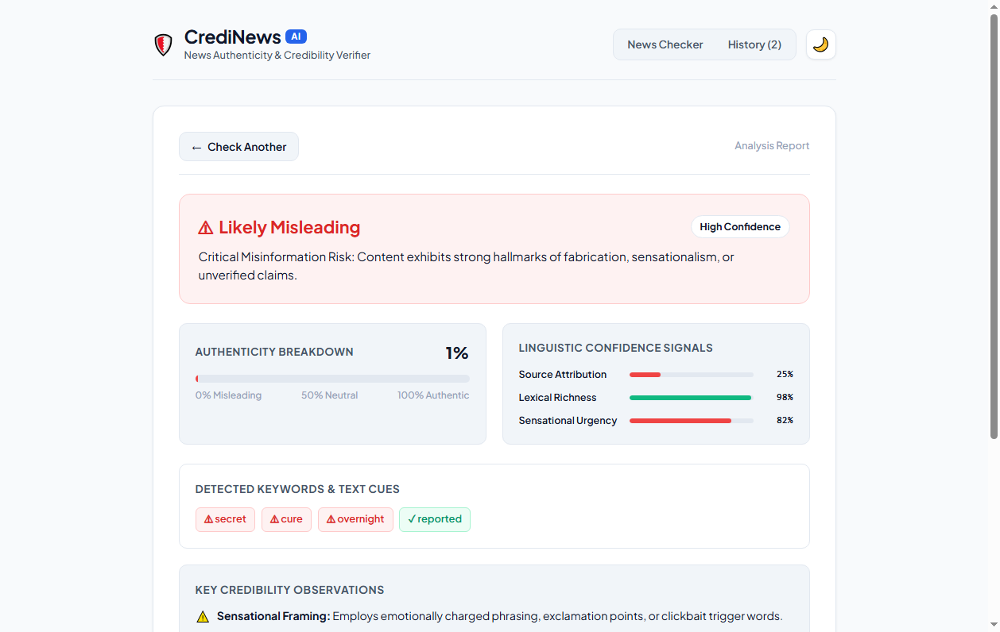
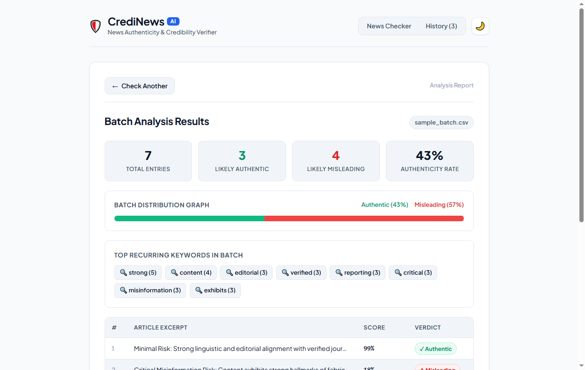
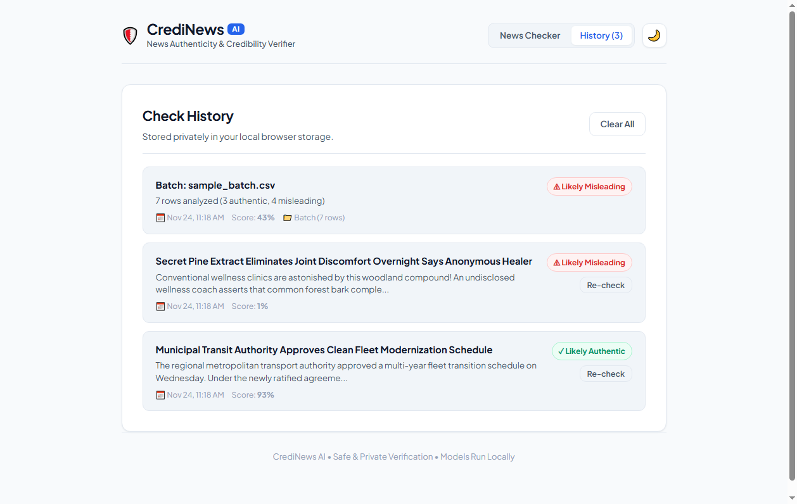

# CrediNews AI: Web Application for Media Credibility Analysis

CrediNews AI is an automated text classification and credibility evaluation web application. It combines calibrated linear support vector classification with n-gram feature representations and stylometric diagnostics to assess text authenticity and flag potential misinformation or sensationalism.

---

## Key Capabilities

- **Real-Time Text Credibility Assessment**: Computes a continuous 0–100 credibility score with confidence levels and risk tiers.
- **Explainability & Linguistic Diagnostics**: Identifies stylometric attributes including lexical diversity, capitalization density, emotional punctuation, and direct attribution markers.
- **Batch Processing Mode**: Evaluates multiple text passages simultaneously via JSON payload or CSV file upload.
- **Self-Contained Web UI**: Modern responsive 2D browser interface with Light/Dark mode, visual graphs, and keyword extraction.
- **RESTful API**: Fully documented OpenAPI endpoints accessible via Swagger UI at `/docs`.

---

## Visual User Guide: How to Read & Use the Application

This visual guide is designed so that **anyone—even with zero technical or machine learning background—can immediately understand what each screen shows, how to test an article, and how to read the visual graphs and indicators.**

---

### Screen 1: The News Checker (Where You Start)

When you first open the app (`http://localhost:8000`), you are greeted by the clean, simple **News Checker** interface.

#### Light Mode View


#### Dark Mode View


#### What an Unknown Reader Needs to Know About This Screen:
1. **Quick Samples (Top Bar)**: If you don't have an article ready to test, click any of the 4 sample buttons (e.g., *Transit Modernization* for real news, or *Overnight Miracle Cure* for fake news). The app will automatically fill in the text for you.
2. **Headline / Title Box**: Paste the news headline here (optional, but helpful for headline clickbait checks).
3. **Article Text Box**: Paste the story, social media post, or news dispatch you want to verify.
4. **Upload File (.csv / .txt)**: If you have a file with dozens or hundreds of news articles, click this button to upload your CSV file and analyze them all in one click.
5. **Theme Switcher (Top Right 🌙 / ☀️)**: Click anytime to toggle between Light Mode and Dark Mode.
6. **"Show Result" Button**: Click this to run the analysis. The app navigates to a dedicated Results Page in less than a second.

---

### Screen 2: Understanding Authentic News Results

When an article follows verified, standard journalistic practices, the app gives it a **"Likely Authentic"** rating.



#### How to Read These Results:
- **Green Top Banner (`✓ Likely Authentic`)**: The primary conclusion. It confirms the article exhibits high factual reliability and standard journalistic phrasing.
- **Authenticity Breakdown Meter (98%)**: A visual bar graph showing the credibility index on a 0% (Extremely Misleading) to 100% (Fully Authentic) scale.
- **Linguistic Confidence Signals**:
  - **Source Attribution (85% - High)**: Shows that the text explicitly quotes real people, named government departments, or recognized agencies.
  - **Lexical Richness (78% - Rich)**: Shows that the text uses diverse, natural human vocabulary rather than repetitive buzzwords.
  - **Sensational Urgency (15% - Low)**: Confirms the article is calm and objective, avoiding exaggerated shock language.
- **Detected Keywords & Phrasing Cues**: Highlights the specific trusted phrases found in the article, such as `✓ according to`, `✓ study`, `✓ ratified`, and `✓ officials said`.
- **"📋 Copy Fact-Check Card" Button**: Copies a clean, shareable summary to your clipboard so you can paste it directly into WhatsApp, Twitter/X, or email.

---

### Screen 3: Understanding Misleading / Fake News Results

When an article contains fabricated claims, unverified health miracles, or manipulative clickbait, the app flags it with a **"Likely Misleading"** warning.



#### How to Spot Misinformation From This Screen:
- **Red Top Banner (`⚠ Likely Misleading`)**: Immediately warns the reader that the text matches known misinformation patterns.
- **Low Authenticity Meter (18%)**: The bar is in the red zone, indicating high risk of fabrication.
- **High Sensational Urgency (82% - Danger)**: The bar turns red, warning that the article uses emotionally manipulative phrases and excessive urgency.
- **Warning Keywords Highlighted**: The app extracts red-flag trigger words so you can see why it was flagged, such as `⚠ secret`, `⚠ cure`, `⚠ miracle`, and `⚠ overnight`.
- **Key Credibility Observations**: Bullet points in plain English explaining that the article lacks primary sources, quotes anonymous or unverified figures, and uses commercial pressure tactics.
- **"← Check Another" Button**: Placed prominently so you can return to check another story immediately.

---

### Screen 4: Batch CSV Verification (Testing Multiple Articles at Once)

For researchers, students, or journalists who need to evaluate a dataset with dozens or hundreds of news articles at the same time, the **Batch CSV** mode provides instant visual analytics.



#### How to Read the Batch Analytics:
- **Summary Metrics (Top Cards)**: Displays the **Total Entries**, how many are **Likely Authentic** (green), how many are **Likely Misleading** (red), and the overall **Authenticity Rate** percentage.
- **Batch Distribution Graph**: A visual ratio bar comparing the proportion of authentic vs. misleading news in the uploaded dataset.
- **Top Recurring Keywords**: Scans the entire file and shows the most frequent keywords appearing across all articles (e.g., `🔍 secret (3)`, `🔍 study (2)`).
- **Interactive Results Table**: A responsive, scrollable list with fixed sticky headers (`#`, `Article Excerpt`, `Score`, `Verdict`). Even with 100+ articles, you can scroll through individual rows smoothly without losing your place.
- **No Page Shift Glitches**: Clean "← Check Another" buttons at both the top and bottom allow you to return to the checker anytime without page jumping.

---

### Screen 5: Check History (Private & Local)

Every article or file you test is automatically saved in your browser's private local storage. No data ever leaves your computer.



#### Features of the History View:
- **Timestamp & Date**: Shows exactly when each article or batch file was checked.
- **Snippet & Headline**: Lets you quickly remember which story was tested.
- **Authenticity Rating Badge**: Color-coded badges (`✓ Likely Authentic` or `⚠ Likely Misleading`) showing the score.
- **"Re-check" Button**: Click on any saved entry to immediately reload the full article back into the checker to re-inspect it.
- **"Clear All" Button**: Erase your search history in one click whenever you want.

---

## System Architecture

The application pipeline operates through the following stages:

1. **Feature Extraction**: Text is transformed into word and character n-gram matrices via TF-IDF vectorization.
2. **Supervised Classification**: A Platt-calibrated Linear Support Vector Classifier calculates posterior probabilities.
3. **Stylometric Verification**: Punctuation patterns, headline capitalization, and lexical variety provide diagnostic explainability.
4. **Scoring & Calibration**: Produces calibrated probabilities, credibility indices, and descriptive risk summaries.

---

## Project Structure

```text
├── backend/
│   ├── app/
│   │   ├── api/
│   │   │   └── routes.py         # REST endpoint controllers
│   │   ├── core/
│   │   │   └── config.py         # Application configuration and paths
│   │   ├── models/
│   │   │   ├── predictor.py      # Core classification engine
│   │   │   ├── schemas.py        # Pydantic request and response models
│   │   │   └── stylometrics.py   # Stylistic & linguistic diagnostics
│   │   └── main.py               # FastAPI application entrypoint
│   ├── static/
│   │   ├── index.html            # Single-page web application UI
│   │   ├── styles.css            # Stylesheet and layout
│   │   └── app.js                # Client-side asynchronous interaction
│   ├── tests/
│   │   └── test_api.py           # Pytest test suite
│   ├── Dockerfile                # Container definition
│   └── requirements.txt          # Python dependencies
├── model_assets/
│   ├── ensemble_config.json      # Classification thresholds & configuration
│   ├── model_1_svc.joblib        # Calibrated LinearSVC model weights
│   └── tfidf_union.joblib        # Scikit-learn FeatureUnion vectorizer
├── docs/
│   └── screenshots/              # UI application interface captures
├── evaluation_reports/
│   └── benchmark_metrics.csv     # Model evaluation statistics
├── docker-compose.yml            # Multi-container orchestration
├── requirements.txt              # Root dependency reference
├── run_backend.py                # Server startup script
├── LICENSE                       # MIT License
└── .gitignore                    # Version control ignore rules
```

---

## Getting Started

### 1. Prerequisites

- Python 3.10 or higher
- Git

### 2. Installation

Clone this repository and create a virtual environment:

```bash
git clone https://github.com/your-username/fake-and-real-news-detection.git
cd "fake and real news detection"

python -m venv .venv

# On Windows:
.venv\Scripts\activate

# On macOS/Linux:
source .venv/bin/activate

pip install -r requirements.txt
```

### 3. Launching the Web Application

Start the local server using the runner script:

```bash
python run_backend.py
```

Open your browser to:
- **Interactive Web Interface**: `http://localhost:8000`
- **Swagger Documentation**: `http://localhost:8000/docs`
- **Health Check**: `http://localhost:8000/api/v1/health`

---

## Running Automated Tests

Execute the unit and integration tests with pytest:

```bash
pytest backend/tests/test_api.py -v
```

---

## Docker Deployment

Build and start the containerized service:

```bash
docker compose up --build
```

The application will be accessible at `http://localhost:8000`.

---

## License

This project is licensed under the MIT License. See the [LICENSE](LICENSE) file for details.
